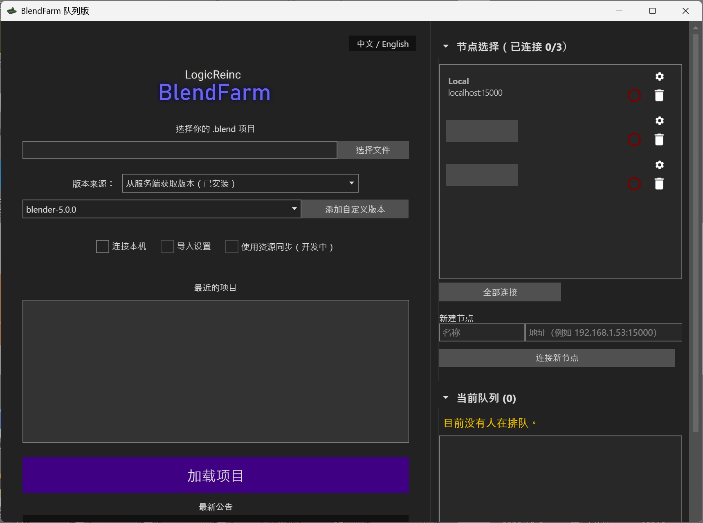

# BlendFarm 队列版（Queue Edition）

**多台电脑共用一台渲染机，按提交先后自动排队，不用再等别人渲完才能点开始。**

> **English:** a fork of [LogicReinc.BlendFarm](https://github.com/LogicReinc/LogicReinc.BlendFarm), a stand-alone network renderer for Blender.
> This edition lets several computers share one render server: jobs are queued first come, first served (an animation is kept together),
> everyone can see the queue and their own position, and the computer hosting the server can move an urgent job to the front.
> Blender versions can be taken from the servers, so computers without internet access can still submit jobs.
> The interface is available in Chinese (optional). **Not compatible with the original BlendFarm** (protocol version 8).
> Licensed under GPL-3.0 like the original, all credit for BlendFarm itself goes to LogicReinc.

## 适合谁用

- 一台性能好的电脑（A）当渲染机，同事的电脑（B、C……）把任务提交给它。
- 原版的问题：A 正在给 C 渲染时，B 点开始会被直接拒绝，只能等 C 渲完。本版本里 B 会自动排在 C 后面，轮到时自动开始。
- 提交任务的电脑可以**断网**，也不需要安装 Blender，只要渲染机上装好了。

## 界面

入口页（中文界面）：左边选 `.blend` 项目和 Blender 版本，右边是"节点选择"和"当前队列"，点击标题可以展开或折叠。
加载项目后右侧保持不变，左侧变成渲染窗口。



## 下载和使用

**Windows x64，免安装，解压即用，不需要安装 .NET。** 到本仓库的 [Releases](../../releases) 下载：

| 文件 | 给谁用 |
|---|---|
| `BlendFarm-Queue-Server-win-x64.zip` | A（只做渲染机），无界面 |
| `BlendFarm-Queue-win-x64.zip` | B、C（提交任务）；A 想自己也渲染时也用它，GUI 自带同样的服务端 |

步骤：

1. **A**：运行 `LogicReinc.BlendFarm.Server.exe` 并保持开着。Windows 防火墙放行 **TCP 15000**。
2. **B、C**：运行 `LogicReinc.BlendFarm.exe`，在右侧"节点选择"里连接 A（没有自动出现就在"新建节点"里填 `A的IP:15000`），选好版本和 `.blend` 文件，照常渲染。

> 只提供并测试了 Windows x64。代码本身是跨平台的，Linux / macOS 可以自己编译，但没有测试过。
>
> **和原版不能互连。** 渲染机和所有提交任务的电脑都要换成本版本，混用会提示"协议版本不一致"。

## 功能

### 排队

- **按项目排队，不按单帧**：B 的整段动画会连续渲完，再轮到 C，不会 B、C 的帧交替（交替会让 Blender 反复重载文件，很慢）。
- 持有者两帧之间有 15 秒保留期，超过 15 秒没发下一帧就让给排队的人。可在渲染机的 `ServerSettings` 文件里改 `QueueLeaseSeconds`。
- 取消任务、关掉软件，只会取消**自己的**任务和排队，不会影响别人正在跑的渲染（原版会误杀）。
- 如果某台电脑还有别的空闲节点，会先用空闲节点；只有所有节点都忙时才排队。

### 当前队列

- 窗口右侧的侧栏，默认折叠，点击展开。标题行直接显示摘要，例如 `当前队列 (2) · 你在 A 排第 2 位`。
- 展开后能看到谁在渲染、谁在排队、各自用时。
- 在渲染机本机的 GUI 里，排队项旁有 **"置顶"** 按钮，把某个人的任务（连同整段动画）移到当前渲染结束后的第一位。
  **只有运行服务端的那台电脑能置顶**，其他电脑只能查看，网络协议里没有任何修改队列的命令。

### 节点选择

- 打开程序就会连接**你以前连过的**节点；局域网自动发现的节点只列出，不会自动连接。
- 点"断开"后，该节点下次不再自动连接；掉线的已选节点每 15 秒自动重连。
- 项目加载前（入口页）和加载后（渲染窗口）右侧是同一份节点和队列，连接不会断。

### Blender 版本

版本下拉框上方可选版本来源，选择会被记住：

- **从服务端获取版本（默认）**：列出各服务端**已安装**的版本，选了就能直接用，不会触发下载，也不需要联网。
- **从 Blender 官网获取**：和原版一样，选了未安装的版本，任务开始后由服务端先去官网下载。

渲染机会自动识别 `BlenderData` 目录里已有的版本，**不需要手动编辑 `VersionCustom`**。
目录名格式为 `版本名-windows64`，例如 `BlenderData\blender-4.5.10-windows64\blender.exe`。
手动解压时如果多套了一层目录（`...\blender-x-windows64\blender-x-windows-x64\blender.exe`），程序会自动移到上一层；
目录里找不到 `blender.exe` 时会给出明确的提示。

### 中文界面（可选）

界面默认跟随系统语言。窗口里有 **"中文 / English"** 按钮，切换后重启生效。没有翻译的文字会原样显示英文。

## 常见问题

**B、C 没有网络，版本下拉框是空的？**
保持默认的"从服务端获取版本"，先在节点选择里连上 A，版本列表会自动出现，并且会记住，下次 A 没开也能看到。

**节点上显示"协议版本不一致"？**
那台电脑上的 BlendFarm 还是旧版（或原版），换成本版本即可。

**连接不上 A？**
多半是 A 的防火墙。放行 TCP 15000；局域网自动发现用的是 UDP 16342 广播，被挡住时手动添加节点即可（地址格式 `IP:端口`，例如 `192.168.0.54:15000`）。

**想给渲染机加连接密码？**
渲染机的 `ServerSettings` 文件里设置 `BasicSecurityPassword`，客户端在节点设置（齿轮图标）里填同样的密码。这只是基础验证，不要当作唯一的保护，更不要暴露到公网。

**渲染出来没有贴图？**
多半是贴图文件没带过去。在 Blender 里用 *文件 → 外部数据 → 自动打包到 .blend*，让远程电脑也有贴图。

**最终成品渲染选哪种策略？**
最终成品用 `Splitted`（每台设备渲一整块，开销最小，但没有分块实时预览）；想看实时预览用 `SplitChunked`。`Chunked` 每个分块都要启动一次 Blender，很慢。

**其他问题**（GPU 渲染、渲染变慢、Gdip、Linux 依赖等）和原版一致，参考原项目的 [FAQ](https://github.com/LogicReinc/LogicReinc.BlendFarm#faq)。

## 原版功能

本版本保留了 BlendFarm 原有的全部功能：多台电脑分摊渲染单张图或动画、支持 CPU 和 GPU（CUDA / OpenCL / OptiX）、
分块渲染、保存文件后自动重新渲染（Live Render）、自动性能分配等。原项目的演示：


*图片来自原项目，SplitChunked 渲染策略的演示。*

## 相对原版的修复

- 修复 `4.5.10` 这类补丁号为两位数的版本永远解析不出来的问题。
- 修复版本缓存是否过期只比较"一年中的第几天"、不比年份，导致一年前的缓存被当成新的。
- 已安装但不在版本列表里的版本，现在也能正常准备并使用。
- 版本列表按数字排序（`4.5.10` 排在 `4.5.4` 前面）。
- 文本框里的中文文件名不再显示成方块。
- 断网时不再等请求超时、也不再弹错误框。

## 从源码构建

需要 .NET SDK（构建机需要，目标电脑不需要）。

```powershell
.\build-win.ps1
```

产物在 `release\`（已被 git 忽略）：两个文件夹和两个 zip，都是自带运行时的单文件程序。

测试（不需要 Blender）：

```powershell
dotnet test LogicReinc.BlendFarm.Tests --filter "FullyQualifiedName~RenderQueueTests|FullyQualifiedName~QueueViewTests|FullyQualifiedName~VersionListTests|FullyQualifiedName~BlenderFolderTests"
```

### 改动了哪里

- 新增 `LogicReinc.BlendFarm.Server/RenderQueue.cs`：队列本体。
- `RenderServerClientTcp.cs`、`BlenderManager.cs`、`RenderServer.cs`：渲染前进队列；取消/断线只作用于自己；向客户端推送队列和版本列表；版本目录检查。
- `LogicReinc.BlendFarm.Shared/`：`Loc.cs`（翻译）、`QueueStatusResponse.cs`、`BlenderVersionsRequest.cs`（新增的只读网络包）、版本列表修复。
- `LogicReinc.BlendFarm.Client/`：忙节点不再被直接丢弃；接收队列状态。
- `LogicReinc.BlendFarm/`：`ServerHub.cs`（全局节点管理）、`Controls/`（折叠侧栏、节点选择、队列）、语言切换。

## 许可证和致谢

- 本项目基于 [LogicReinc/LogicReinc.BlendFarm](https://github.com/LogicReinc/LogicReinc.BlendFarm)，**BlendFarm 本身的全部功劳属于原作者 LogicReinc**。
  如果你喜欢这个软件，欢迎支持原作者：<https://patreon.com/LogicReinc>。
- 许可证与原项目相同：[GNU GPL v3.0](LICENSE)。你可以自由使用、修改和分发，但分发（包括修改后的版本）时必须同样以 GPL-3.0 提供源码。
- 界面里的 Patreon 等链接指向原作者，保留未改。
